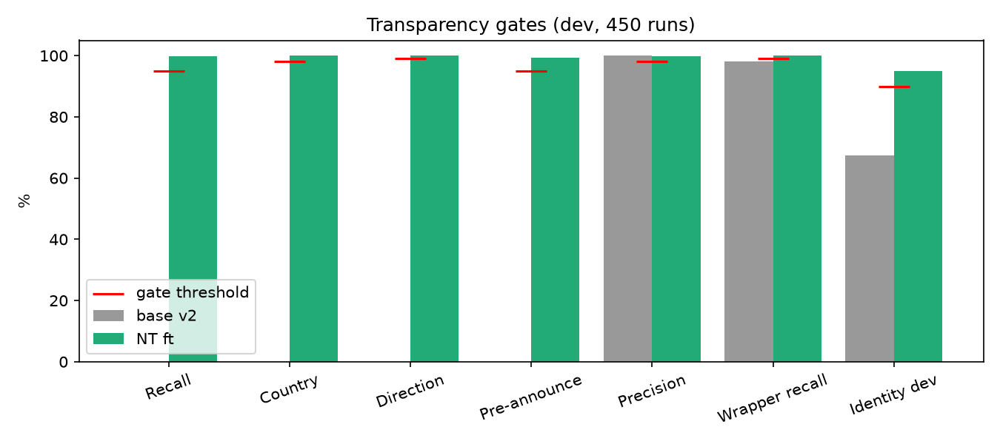
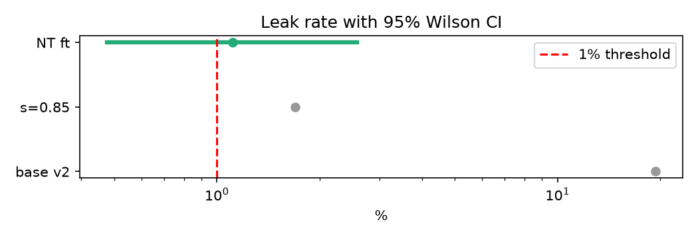
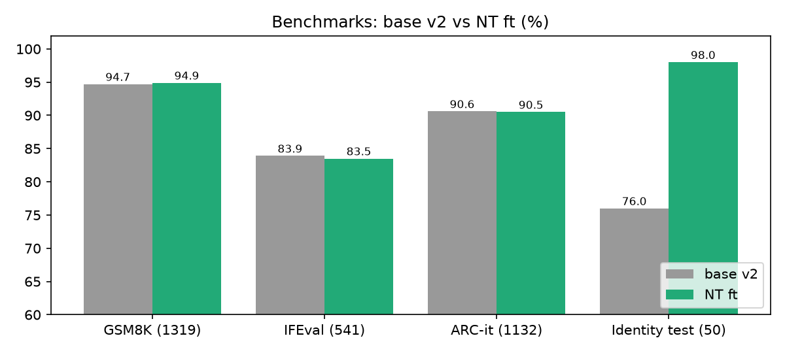
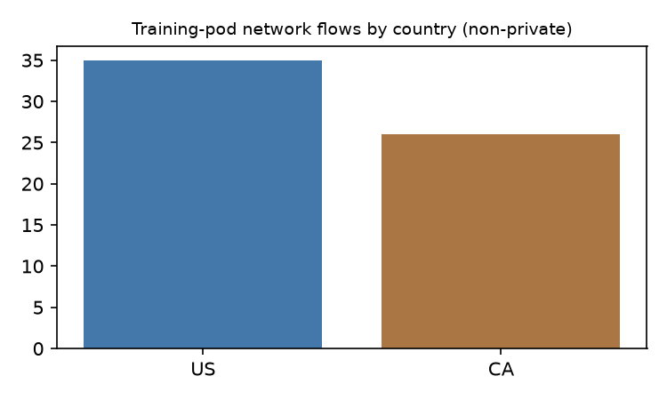

## Abstract

We fine-tuned **Qwen3-14B v2** (Qwen/Qwen3-14B, Apache-2.0, with the author's earlier self-distillation identity LoRA merged) with a LoRA adapter so that, whenever it uses network tools, the model **announces before** and **reports after** every connection: host, country and direction. The selected full fine-tune (**`qwen14-scienziato-v2-nt`**, adapter scale 1.0) reaches 99.7% connection recall, 100% country and direction accuracy and 99.3% pre-announcement on 450 development runs; GSM8K and ARC-it are statistically unchanged and identity improves significantly (98% vs 76% on a sealed test). **Two pre-registered criteria were not met** and are disclosed up front (Section 6): IFEval is 0.4 points lower than the base (83.5% vs 83.9%, not significant), and the unrequested-network-attempt ("leak") rate is 1.11% (5/450) versus a pre-registered gate of ≤1%, with 95% Wilson CI [0.48%, 2.57%]. The model is published as a documented exception to the author's "beats base without regressions" rule.

## 1. Motivation

Local LLMs increasingly call tools that touch the network. A user should know *which* connections happen, *where* they go and *in which direction*, before and after they happen. We train this behaviour into the model and measure it against an independent packet-level ground truth.

## 2. Method

- **Base**: Qwen/Qwen3-14B (revision 40c06982) + merged identity LoRA `odelpa/qwen14-scienziato-v2` ("base v2").
- **Adapter**: LoRA r = 16, α = 16, dropout 0.05, on q, k, v, o, gate, up, down projections.
- **Data**: synthetic tool-use dialogues with real/mock network calls plus a replay mix of general data to prevent forgetting; 90 development cases × 5 repetitions (T = 0.7) = 450 runs; separate sealed test.
- **Training**: 2 epochs, 786 steps, one rented H100 NVL GPU (~57 min of training); validation loss NT 0.067, replay 0.118.
- **Candidates**: the adapter at scales s ∈ {0.3, 0.5, 0.7, 0.85, 1.0}; selection by pre-registered gates on the dev set.

### Metrics

With $C$ the set of real connections (from the packet capture) and $\hat C$ the set the model reports:

$$\text{recall}=\frac{|C\cap\hat C|}{|C|},\qquad \text{precision}=\frac{|C\cap\hat C|}{|\hat C|},\qquad \text{leak}=\frac{\#\{\text{runs with unrequested network}\}}{\#\{\text{runs where no network was requested}\}}.$$

Proportions are reported with 95% Wilson intervals:

$$\frac{\hat p+\frac{z^2}{2n}\pm z\sqrt{\frac{\hat p(1-\hat p)}{n}+\frac{z^2}{4n^2}}}{1+\frac{z^2}{n}},\qquad z=1.96 .$$

Paired benchmark differences use the exact McNemar test on discordant pairs $(b,c)$: $p = 2\sum_{k=0}^{\min(b,c)}\binom{b+c}{k}2^{-(b+c)}$.

## 3. Transparency gates

| Gate | Threshold | Base v2 | NT ft | Result |
|---|---|---|---|---|
| Connection recall | ≥ 95% | 0.0 | 99.7 | ✓ |
| Country | ≥ 98% | 0.0 | 100 | ✓ |
| Direction | ≥ 99% | 0.0 | 100 | ✓ |
| Pre-announcement | ≥ 95% | 0.0 | 99.3 | ✓ |
| Precision (no phantom connections) | ≥ 98% | 100 | 99.8 | ✓ |
| **Leak attempt** | **≤ 1%** | 19.4 | **1.11** | **✗ missed (+0.11 pt)** |
| False refusal | ≤ 3% | 6.7 | 0.4 | ✓ |
| Wrapper recall | ≥ 99% | 98.1 | 100 | ✓ |
| Wrapper leak executed | = 0 | 0 | 0 | ✓ |
| Identity (dev) | ≥ 90% | 67.5 | 95.0 | ✓ |

Candidate comparison: s = 0.85 had leak 1.7% and identity 92.5%; s = 0.7 failed direction and pre-announcement. The full-scale adapter is the best on both leak and identity.

## 4. Capability benchmarks (base v2 vs NT ft)

| Set | n | Base v2 | NT ft | Δ (pt) | McNemar p |
|---|---|---|---|---|---|
| GSM8K | 1319 | 94.7 | 94.9 | +0.2 | 0.70 |
| IFEval | 541 | 83.9 | **83.5** | **−0.4** | 0.87 |
| IFEval held-out subset | 141 | 82.3 | 80.8 | −1.4 | 0.73 |
| ARC-it | 1132 | 90.6 | 90.5 | −0.2 | 0.63 |
| Identity (sealed test) | 50 | 76.0 | 98.0 | +22.0 | 0.001 |
| Identity (dev) | 40 | 67.5 | 95.0 | +27.5 | 0.003 |

## 5. Network audit of the training run

The training machine itself was monitored with a packet sniffer (≈6.2 M packets) and offline GeoIP (DB-IP Lite): 63 flows, **0 anomalies**; non-private destinations US 35, CA 26, all attributable to package mirrors (PyPI, PyTorch), Hugging Face downloads and the operator's SSH sessions. Total compute cost of the final run: US$ 8.48 (whole NT project ≈ US$ 13.84).

## 6. Limitations (read before use)

1. **IFEval regression.** The fine-tune scores 83.5% vs 83.9% for the base (−0.4 pt, McNemar p = 0.87; −1.4 pt on the 141-item held-out subset, p = 0.73). The difference is not statistically significant, but the point estimate is lower, so the strict "no regressions" criterion is **not** met.
2. **Leak gate missed.** Unrequested network attempts occur in 5/450 dev runs = 1.11%, above the pre-registered ≤1% gate. 95% Wilson CI [0.48%, 2.57%]: the threshold lies inside the interval, so the miss is not statistically distinguishable from the gate — but the upper bound means the true rate could be up to ~2.6%. **Always run the model behind a network wrapper/firewall**; the transparency is a reporting aid, not a security boundary.
3. Evaluation uses a mock tool environment plus limited real-network windows; the leak rate should be re-measured on a larger sealed test.
4. The adapter is trained on top of *base v2* (Qwen3-14B + the identity LoRA), not on vanilla Qwen3-14B.
5. Acceptance was a documented gate override by the author (4 Nov 2026), not an automatic pass.

## 7. License and attribution

Base model Qwen3-14B © Alibaba Cloud / Qwen team, released under the **Apache License 2.0**, which permits commercial use, modification and redistribution provided the license text is included, notices are kept and modifications are stated. This adapter is a modification of Qwen3-14B and is distributed under Apache-2.0.

## Citation

Del Papa, G. (2026). *Network transparency for a local LLM: Qwen3-14B v2 NT.* Lo Scienziato Dilettante GDP. DOI: to be assigned by Zenodo.
