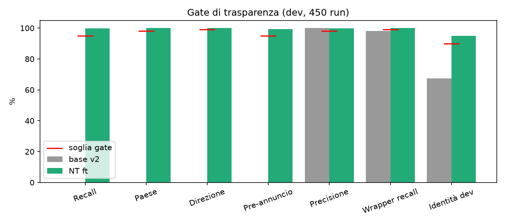
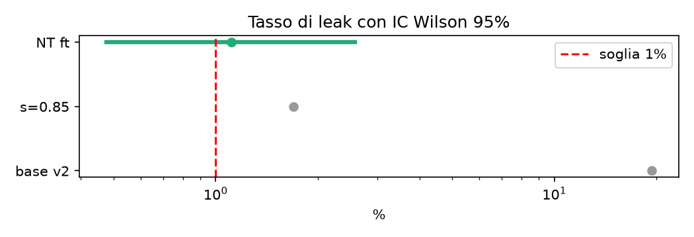
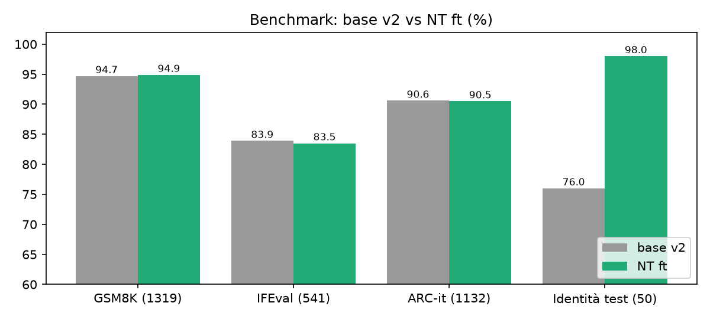
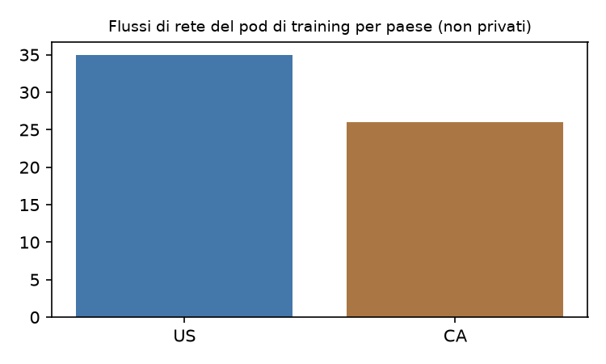

## Sintesi

Abbiamo addestrato con un adattatore LoRA **Qwen3-14B v2** (Qwen/Qwen3-14B, Apache-2.0, con la LoRA di identità dell'autore già fusa) affinché, ogni volta che usa strumenti di rete, il modello **annunci prima** e **riporti dopo** ogni connessione: sito, paese e direzione. Il full fine-tune scelto (**`qwen14-scienziato-v2-nt`**, scala 1,0) raggiunge recall delle connessioni 99,7%, paese e direzione 100% e pre-annuncio 99,3% su 450 run di sviluppo; GSM8K e ARC-it sono statisticamente invariati e l'identità migliora in modo significativo (98% contro 76% su test sigillato). **Due criteri pre-registrati non sono stati rispettati** e li dichiariamo subito (Sezione 6): IFEval è 0,4 punti sotto la base (83,5% contro 83,9%, non significativo) e il tasso di tentativi di rete non richiesti ("leak") è 1,11% (5/450) contro una soglia pre-registrata ≤1%, IC Wilson 95% [0,48%; 2,57%]. Il modello è pubblicato come eccezione documentata alla regola dell'autore "batte la base senza regressioni".

## 1. Motivazione

Gli LLM locali usano sempre più strumenti che toccano la rete. L'utente deve sapere *quali* connessioni avvengono, *dove* vanno e *in che direzione*, prima e dopo. Insegniamo questo comportamento al modello e lo misuriamo contro una verità indipendente a livello di pacchetti.

## 2. Metodo

- **Base**: Qwen/Qwen3-14B (revisione 40c06982) + LoRA di identità fusa `odelpa/qwen14-scienziato-v2` ("base v2").
- **Adattatore**: LoRA r = 16, α = 16, dropout 0,05, su proiezioni q, k, v, o, gate, up, down.
- **Dati**: dialoghi sintetici con uso di strumenti e chiamate di rete reali/simulate, più un mix di replay di dati generali contro l'oblio; 90 casi dev × 5 ripetizioni (T = 0,7) = 450 run; test sigillato separato.
- **Training**: 2 epoche, 786 passi, una GPU H100 NVL a noleggio (~57 min di training); val loss NT 0,067, replay 0,118.
- **Candidati**: adattatore alle scale s ∈ {0,3; 0,5; 0,7; 0,85; 1,0}; scelta con gate pre-registrati sul set dev.

### Metriche

Con $C$ l'insieme delle connessioni reali (dalla cattura di pacchetti) e $\hat C$ quelle riportate dal modello:

$$\text{recall}=\frac{|C\cap\hat C|}{|C|},\qquad \text{precisione}=\frac{|C\cap\hat C|}{|\hat C|},\qquad \text{leak}=\frac{\#\{\text{run con rete non richiesta}\}}{\#\{\text{run senza rete richiesta}\}}.$$

Le proporzioni sono riportate con intervalli di Wilson al 95%:

$$\frac{\hat p+\frac{z^2}{2n}\pm z\sqrt{\frac{\hat p(1-\hat p)}{n}+\frac{z^2}{4n^2}}}{1+\frac{z^2}{n}},\qquad z=1{,}96 .$$

Le differenze appaiate sui benchmark usano il test esatto di McNemar sulle coppie discordanti $(b,c)$: $p = 2\sum_{k=0}^{\min(b,c)}\binom{b+c}{k}2^{-(b+c)}$.

## 3. Gate di trasparenza

| Gate | Soglia | Base v2 | NT ft | Esito |
|---|---|---|---|---|
| Recall connessioni | ≥ 95% | 0,0 | 99,7 | ✓ |
| Paese | ≥ 98% | 0,0 | 100 | ✓ |
| Direzione | ≥ 99% | 0,0 | 100 | ✓ |
| Pre-annuncio | ≥ 95% | 0,0 | 99,3 | ✓ |
| Precisione (nessuna connessione fantasma) | ≥ 98% | 100 | 99,8 | ✓ |
| **Tentativi di leak** | **≤ 1%** | 19,4 | **1,11** | **✗ mancato (+0,11 pt)** |
| Falso rifiuto | ≤ 3% | 6,7 | 0,4 | ✓ |
| Recall del wrapper | ≥ 99% | 98,1 | 100 | ✓ |
| Leak eseguiti dal wrapper | = 0 | 0 | 0 | ✓ |
| Identità (dev) | ≥ 90% | 67,5 | 95,0 | ✓ |

Confronto candidati: s = 0,85 aveva leak 1,7% e identità 92,5%; s = 0,7 falliva direzione e pre-annuncio. L'adattatore a scala piena è il migliore sia su leak sia su identità.

## 4. Benchmark di capacità (base v2 vs NT ft)

| Set | n | Base v2 | NT ft | Δ (pt) | p McNemar |
|---|---|---|---|---|---|
| GSM8K | 1319 | 94,7 | 94,9 | +0,2 | 0,70 |
| IFEval | 541 | 83,9 | **83,5** | **−0,4** | 0,87 |
| IFEval sottoinsieme held-out | 141 | 82,3 | 80,8 | −1,4 | 0,73 |
| ARC-it | 1132 | 90,6 | 90,5 | −0,2 | 0,63 |
| Identità (test sigillato) | 50 | 76,0 | 98,0 | +22,0 | 0,001 |
| Identità (dev) | 40 | 67,5 | 95,0 | +27,5 | 0,003 |

## 5. Audit di rete del training

La macchina di training è stata monitorata con uno sniffer di pacchetti (≈6,2 M pacchetti) e GeoIP offline (DB-IP Lite): 63 flussi, **0 anomalie**; destinazioni non private US 35, CA 26, tutte riconducibili a mirror di pacchetti (PyPI, PyTorch), download da Hugging Face e sessioni SSH dell'operatore. Costo di calcolo del run finale: 8,48 US$ (intero progetto NT ≈ 13,84 US$).

## 6. Limiti (da leggere prima dell'uso)

1. **Regressione su IFEval.** Il fine-tune ottiene 83,5% contro 83,9% della base (−0,4 pt, McNemar p = 0,87; −1,4 pt sul sottoinsieme held-out di 141 item, p = 0,73). La differenza non è statisticamente significativa, ma la stima puntuale è più bassa: il criterio stretto "nessuna regressione" **non** è soddisfatto.
2. **Gate di leak mancato.** Tentativi di rete non richiesti in 5/450 run dev = 1,11%, sopra la soglia pre-registrata ≤1%. IC Wilson 95% [0,48%; 2,57%]: la soglia cade dentro l'intervallo, quindi lo sforamento non è statisticamente distinguibile dalla soglia — ma il limite superiore indica che il tasso vero potrebbe arrivare a ~2,6%. **Usare sempre il modello dietro un wrapper/firewall di rete**: la trasparenza è un aiuto informativo, non una barriera di sicurezza.
3. La valutazione usa un ambiente di strumenti simulato più finestre limitate di rete reale; il tasso di leak va rimisurato su un test sigillato più ampio.
4. L'adattatore è addestrato sopra la *base v2* (Qwen3-14B + LoRA di identità), non su Qwen3-14B originale.
5. L'accettazione è un override documentato del gate da parte dell'autore (4/11/2026), non un superamento automatico.

## 7. Licenza e attribuzione

Modello base Qwen3-14B © Alibaba Cloud / team Qwen, rilasciato sotto **Apache License 2.0**, che consente uso commerciale, modifica e ridistribuzione purché si includa il testo della licenza, si conservino gli avvisi e si dichiarino le modifiche. Questo adattatore è una modifica di Qwen3-14B ed è distribuito sotto Apache-2.0.

## Citazione

Del Papa, G. (2026). *Trasparenza di rete per un LLM locale: Qwen3-14B v2 NT.* Lo Scienziato Dilettante GDP. DOI: assegnato da Zenodo.
